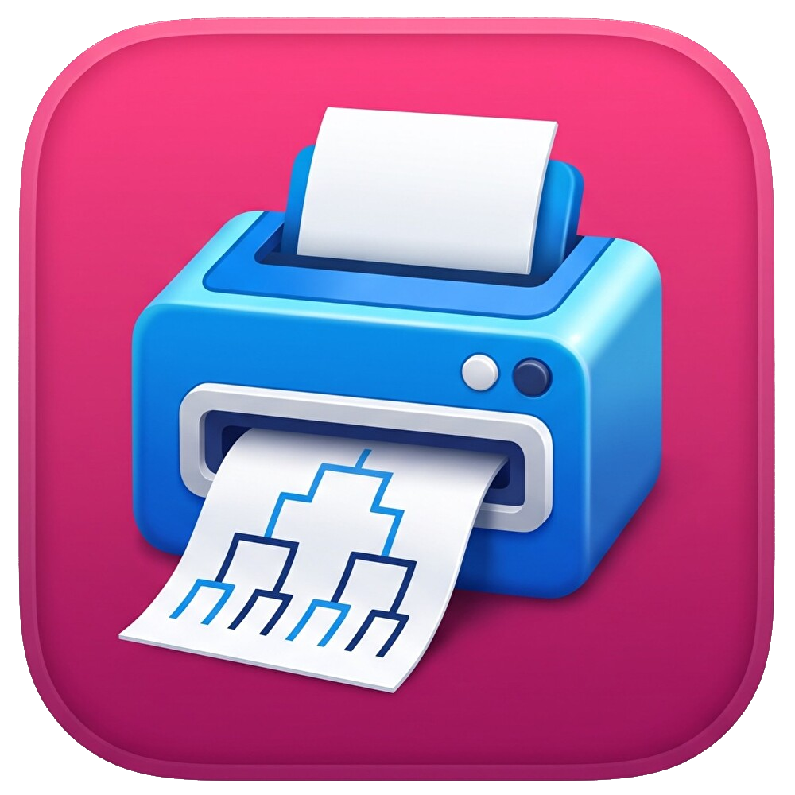

<div align="center">



# Bracket Printer

**start.ggを使ったトーナメント表を見やすく！使いやすく！**<br>
オフライン大会の運営・進行を加速させる、超軽量ブラケット＆チェックイン名簿PDF作成Webアプリ

[](https://tesnoo.github.io/BracketPrinter/)
[](#under-the-hood)
[](#everything-in-the-box)
[](#presets-and-api)
[](https://github.com/Tesnoo/BracketPrinter/releases)

[**🌐 Webアプリを開く (tesnoo.github.io/BracketPrinter)**](https://tesnoo.github.io/BracketPrinter/) · [**🐦 Contact (@Tesnoo_ssb)**](https://x.com/Tesnoo_ssb)

---

[✨ 特徴](#features) · [📦 搭載機能一覧](#everything-in-the-box) · [🏆 大会プリセット & API連携](#presets-and-api) · [🔧 内部構造 (Under the hood)](#under-the-hood) · [🚀 使い方](#get-started)

</div>

<br>

<table>
  <tr>
    <td width="50%" valign="top">
      <h3>⚡ コンビニ印刷でも爆速・超軽量</h3>
      <p>1プールあたり<strong>約190〜200KB</strong>の純粋ベクター＆軽量データ構造。start.gg標準PDFの約1/3のデータサイズに抑え、コンビニのマルチコピー機や会場プリンターでの「データ展開待ち（RIP処理落ち）」を根本から解消します。</p>
    </td>
    <td width="50%" valign="top">
      <h3>🔗 start.gg API & CSV ハイブリッド対応</h3>
      <p>Bracket URLを貼るだけで、参加者シード・エリミネーション形式・通過人数・次フェーズ名までGraphQL APIから自動推論。もちろんstart.ggから出力したシードCSVファイルの直接アップロードにも対応しています。</p>
    </td>
  </tr>
  <tr>
    <td width="50%" valign="top">
      <h3>📐 6〜32人・全進行パターンを美しく描画</h3>
      <p>予選プール（W1/W2/W4・L1/L2/L4/L8抜け）から、<strong>Grand Final Resetまで1枚で完結するトナメ（W0L0）</strong>まで完全網羅。A4横で印刷してもプレイヤー名記入欄が4mm以上確保されるよう、余白と高さを自動計算します。</p>
    </td>
    <td width="50%" valign="top">
      <h3>🏆 主要大会プリセット＆自由な装飾</h3>
      <p>大会ナンバリングを入れるだけで大会名・URL・Bo設定・右下ロゴまで一括セットされるプリセット機能を搭載。シート上にはチェックイン名簿が自動配置され、ドラッグ移動可能なテキストボックスや大会ロゴも追加できます。</p>
    </td>
  </tr>
</table>

---

## <a id="features"></a>✨ Features（特徴とこだわり）

オフライン大会の現場で「紙のトーナメント表」を扱うスタッフ・進行係が直面する課題を解決するために設計されています。

### 🖊️ 手書きしやすく、読み間違えないブラケット設計
* **十分な記入高の自動確保**：6〜16人規模でラウンド列数が増える構成（Grand Final Resetまで進行するW0L0など）では、シート下部の余白を活かして試合ボックスの縦幅を自動拡大（最大 `68px`）。A4横印刷でも記入欄の高さが `$4\text{ mm}$` 以上確保されます。
* **完全正方形のスコア記入欄**：ボックスの高さが動的に変化しても、スコア欄の横幅が連動計算され、常に書きやすい**正方形**を維持します。
* **直感的な進行ガイドとチェックボックス**：各試合ボックスの左に進行管理用のチェックボックスと試合記号（`A`, `B`, `C`...）を配置。敗者側への落下元（`Loser of XX`）や通過先フェーズ枠（二重線＋太破線コネクタ）も一目で判別できます。

### 📋 Check-in / Gamer Tag 名簿テーブルの統合
* ブラケット右上のデッドスペースに、シード順の**チェックイン名簿（Check-in チェックボックス ＋ フルGamerTag一覧）**を自動配置。
* ブラケット上の試合枠には視認性の高い `Short GamerTag`（スポンサー・チーム名を除いたタグ）を表示し、右上名簿にはプレフィックス付きの `Full GamerTag` を表示することで、受付時の本人確認とトーナメント進行を1枚のシートで完結できます。

### 🖨️ 単一出力も、全プール一括出力も1クリックで
* **現在のPoolをPDF出力**：選択中のプール1枚だけを即座に印刷・PDF化。
* **全PoolをPDF一括出力**：フェーズ内の全プール（例：8プール〜16プール以上）を、1pxの狂いも余白のズレもなく連続ページとして一括PDF化。全ページに大会ロゴやカスタムテキストが確実に反映されます。

---

## <a id="everything-in-the-box"></a>📦 Everything in the box（搭載機能一覧）

### 📊 対応ブラケット規模・形式
* **対応人数**：1プールあたり **6人 〜 32人**（6〜8人 / 9〜12人 / 13〜16人 / 17〜24人 / 25〜32人の5段階最適化アルゴリズム）
* **トーナメント形式**：ダブルエリミネーション ／ シングルエリミネーション
* **勝者側（Winners）通過人数**：`0人`（GFまで完結） · `1人` · `2人` · `4人`（※8人以下のプールでは4人を自動制限）
* **敗者側（Losers）通過人数**：`0人`（GFまで完結） · `1人` · `2人` · `4人` · `8人`（※16人以下のプールでは8人を自動制限）
* **Grand Final 完結モード（W0L0）**：`Winners Final` → `Grand Final` → `Grand Final Reset`（`Winner of GF` / `Loser of GF` ラベル付き）および `Losers Final` からの合流を1シート内に描画

### ⚙️ セット数（Best of）設定・ラウンド別変更
* **基本最大セット数**：`Bo5 (3本先取)` · `Bo3 (2本先取)` · `その他（任意の奇数をカスタム入力）`
* **途中ラウンドからのセット数変更**：
  * 現在の人数・通過人数設定で**実際に存在するラウンドのみ**を動的にプルダウン表示（例：`Winners Semi-Final 以降`、`Losers Quarter-Final 以降` など）
  * 勝者側・敗者側それぞれ独立して変更開始ラウンドと変更後のBo数（Bo5 / Bo3 / カスタム奇数）を指定可能

### 🖨️ 印刷オプション・プレビュー制御
* **推奨設定オートナビ**：最大プール人数とエリミネーション形式から最適な用紙サイズ・向きを自動選択（例：17〜32人ダブルエリミ＝`A3 横`、6〜16人ダブルエリミ＝`A4 横`、シングルエリミ＝`A4 縦`）
* **対応用紙サイズ**：`A3` · `B4` · `A4` · `B5` · `A5`（横 Landscape / 縦 Portrait 切替）
* **余白プリセット**：`標準` · `広い` · `狭い`
* **ヘッダー表示制御**：
  * 大会名・フェーズ名の自動結合（フェーズ名表示のON/OFF切替対応）
  * 複数プール時は `{大会名} {フェーズ名}　Pool {Pool名} - {形式} ({人数} players)`、1プールのみ存在する場合は `Pool 1` を省略して `{大会名} {フェーズ名}　{形式} ({人数} players)` と自動整形
  * `W0L0`（GF完結）時は不要な `Qualifier` サブタイトルと通過先フェーズ名入力を自動で非表示・ロック
* **ズーム＆出力**：`20%〜120%` スライダー、`画面に合わせる` ボタン、高解像度 **JPG画像保存**、**単一PDF出力**、**全Pool一括PDF出力**

### 🎨 描画オプション（シート装飾）
* **右下ロゴ追加**：白黒（グレースケール）PNG画像の自動検証機能付き。縦上限 `160px` を超える画像はアスペクト比を保ったまま自動縮小。
* **カスタムテキストボックス**：プレビュー上に複数のテキストボックスを追加し、ドラッグ＆ドロップで自由配置。文字サイズ（`小 14px` / `中 18px` / `大 24px` / `特大 32px`）の変更・削除が可能（印刷時は操作枠が自動で消えます）。

---

## <a id="presets-and-api"></a>🏆 Presets & start.gg API（主要大会プリセットとAPI連携）

### 主要大会プリセット
サイドバーの「主要大会プリセット」を選択し、**大会のナンバリング（半角数字 `$n$`）** を入力するだけで、大会名・Bracket URL・セット数ルール・右下ロゴが自動設定されます。

| プリセット名 | 競技選択 | 自動設定される大会名 | 自動生成される Bracket URL | 自動セット数設定 | 自動適用ロゴ |
| :--- | :---: | :--- | :--- | :--- | :--- |
| **Vic-Seekers** | — | `Vic-Seekers #n` | `.../tournament/vic-seekers-n/event/ultimate-singles` | 手動 / API推論 | `vix_logo_black_outline.png` |
| **クロブラ** | **SP / Ultimate** | `第n回クロブラ` | `.../tournament/n-kurobran/event/kurobra-sp-1on1` | 基本 **Bo3**<br>WSF & LQF以降 **Bo5** | `kurobra_logo.png` |
| **クロブラ** | **DX / Melee** | `第n回クロブラ` | `.../tournament/n-kurobran/event/kurobra-melee-singles` | 全試合 **Bo5** | `kurobra_logo.png` |
| **IMPACT MAJOR** | — | `IMPACT MAJOR#n` | `.../tournament/impact-major-n/event/singles-tournament` | 全試合 **Bo5** | `impact_ major_logo.png` |
| **篝火 / ウメブラ / スマバト / マエスマ'TOP** | — | `{大会名} #n` | （順次拡張予定） | — | — |

### start.gg API からの自動推論エンジン
`start.ggからデータを取得` を押すと、GraphQL API経由で以下の情報を自動解析します。
1. **複数フェーズ＆プール自動展開**：イベント内の全フェーズ（予選・Top 192・Top 48など）を取得し、プルダウンで切り替え可能。URLに特定の `phaseId` や `phaseGroupId` が含まれている場合はそのプールを自動選択します。
2. **通過人数の自動逆算**：PhaseGroup内のセット構造（最終ラウンドの試合数）および `progressionsOut` の件数から、`W1L1` / `W1L2` / `W2L2` / `W2L4` / `W4L4` / `W4L8` または `W0L0（GFまで進行）` を自動で判定してプルダウンにセットします。
3. **通過先フェーズ名の自動取得**：`phaseOrder` に基づき、現在選択しているフェーズの「次のフェーズ名」を通過先フェーズ名入力欄へ自動で埋め込みます。

---

## <a id="under-the-hood"></a>🔧 Under the hood（なぜここまでPDFが軽く、印刷が速いのか）

start.gg標準のPDF出力や一般的なWebページ印刷では、16プール分のPDFが数MB〜十数MBに肥大化し、コンビニのマルチコピー機やレーザープリンターで1枚ごとに長い処理待ち（RIP処理遅延）が発生することがありました。Bracket Printerでは以下のアーキテクチャによって**1プールあたり約190KB**の超軽量出力を実現しています。

* **透過PNGの排除と不透明JPEGフラット化**：
  PDF（特にWindowsの印刷スプーラ）は、ページ内に1つでもアルファチャンネル（透過）を持つPNG画像が存在すると、透過合成のために周囲のベクター罫線や文字まで高解像度ビットマップ画像へラスタライズしてしまいます。本アプリではロゴ読み込み時にCanvas上で白背景（`#ffffff`）と合成して透過情報を排除し、軽量な不透明JPEGデータ（品質0.85）へ変換してから配置しています。
* **100%純粋ベクター罫線とOSネイティブフォント**：
  通過先フェーズへの点線コネクタ等にCSSグラデーション（`repeating-linear-gradient`）を使うとPDF変換時に大量の画像パターンが生成されるため、すべて純粋なベクター命令となる `border`（`solid` / `dashed` / `double`）のみで描画しています。さらにWebフォントの埋め込みを廃止し、OS標準フォントのみを使用することでフォントサブセットの肥大化を防いでいます。
* **非表示DOMノードの完全プルーニング（枝刈り）**：
  印刷用シートを生成する際、非表示のプレースホルダー（`.hidden`）やテキストボックスの操作ヘッダー（`.text-box-controls`）をDOMツリーから完全に `.remove()` し、PDFストリーム内のオブジェクト数を最小化しています。
* **`contain: strict` による二重縮小防止と非同期デコード待機**：
  一括印刷時に各ページラッパーへ `contain: strict; overflow: hidden;` と実寸幅固定を適用し、ブラウザの印刷エンジンが縮小前のキャンバス幅を誤検知して二重縮小（Shrink-to-Fitの誤作動）を起こす現象を防止。さらに全ページの `img.decode()` と2フレーム分の `requestAnimationFrame` 完了を待ってから印刷ダイアログを起動することで、最終ページ以外のロゴが欠落するブラウザ固有の描画バグを完全に解消しています。

---

## <a id="get-started"></a>🚀 Get started（使い方）

### Web上で今すぐ使う（インストール不要）
ブラウザから **[https://tesnoo.github.io/BracketPrinter/](https://tesnoo.github.io/BracketPrinter/)** にアクセスするだけで、すべての機能を利用できます。

1. **プリセットまたは大会名の入力**：主要大会プリセットを選ぶか、任意の大会名を入力します。
2. **参加者データの取得**：
   * **CSVの場合**：start.ggから出力したシードCSVファイルを選択します。
   * **APIの場合**：start.ggのDeveloper Settingsで発行した `API token` と大会の `Bracket URL` を貼り付け、「start.ggからデータを取得」をクリックします。
3. **ルールの確認・指定**：トーナメント形式、フェーズ通過人数（GFまで進行する場合は `0人 / 0人`）、基本最大セット数（Bo3 / Bo5等）、通過先のフェーズ名を確認します。
4. **ブラケットを描画する**：オレンジ色の「ブラケットを描画する」ボタンを押すとプレビューが生成されます。
5. **PDF出力 / 画像保存**：左下のボタンから「現在のPoolをPDF出力」または「全PoolをPDF一括出力」を実行し、ブラウザの印刷ダイアログで「PDFに保存」またはプリンターを選択して出力します。

### ローカル環境で動かす場合
外部ビルドツールやバックエンドサーバーは一切不要です。リポジトリをクローンして `index.html` を開くだけで動作します。

```bash
git clone https://github.com/Tesnoo/BracketPrinter.git
cd BracketPrinter
# 任意のローカルサーバーまたはブラウザで index.html を開く
npx serve .
```